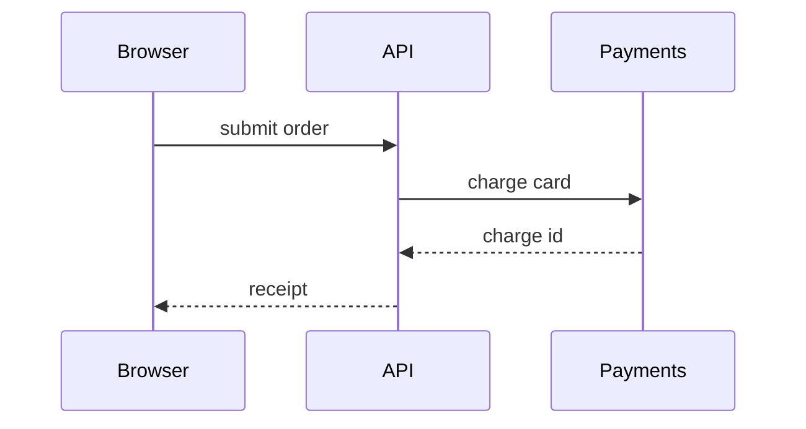

# show-me

Run this skill when the user ran `/show-me`, when the request matches the description, or when another skill invokes it. When you start it without `/show-me` and no skill asked for it, say so in one line so the user can redirect.

Help the reader see the point. Pick the smallest view that makes the key point clear, and keep prose to the one or two lines it supports. When a visual needs a paragraph of explanation, it is the wrong visual.

## Input

- **Topic.** What the user asked to see. With nothing named, the point under discussion right now. A calling skill names it.
- **Reader.** The user in this conversation, unless the caller names another: a reviewer who was not in the conversation, for a PR.
- **Destination.**
  - **Chat**, the default: any form below, including an HTML page.
  - **Published Markdown**, when a caller says the visual goes into a PR body, an issue, or a doc: only fenced blocks that render there. GitHub renders `text`, `diff`, `mermaid`, and code blocks. No HTML file, no local path, no image from disk. Hand the blocks back to the caller with at most one line of text each; the caller places them.

## Ground it first

Every name in a visual is a claim, and follows [principles/show-the-evidence.md](principles/show-the-evidence.md). Before drawing:

- Read the code the visual shows in this session. Every file, function, component, prop, and state carries its real name, and every path is a real path.
- Draw a change from the diff (`git diff`, or the change the caller names), not from memory of the conversation.
- Use the terms in `docs/GLOSSARY.md` when the repo has one.
- Keep only the calls, files, props, states, and boundaries the reader needs for the current question, or to choose between the options on the table. Drop the rest, even when true. A dozen Mermaid nodes is the ceiling: past that, split it or use a tree.

## Forms

Use one. Use two when comparing. Rarely more.

**Logic or an algorithm** as pseudocode:

```text
on(upload)
  if the file hash is already stored
    return the stored record
  store the file
  return a new record
```

**Runtime control flow** as a call tree:

```text
handleCheckout
  loadCart
  priceCart
    applyDiscounts
  createOrder
    reserveStock
  redirectToReceipt
```

**UI structure** as a component tree, with the state and module boundaries that matter:

```tsx
<CheckoutPage> (apps/web/src/routes/checkout.tsx)
  useCart()
  <OrderSummary>
    <DiscountField> (packages/ui)
  <PayButton>
```

**File responsibility or a broad refactor** as a shallow file tree:

```text
src/
├── cart/        # owns cart state
├── pricing/     # computes totals and discounts
└── payments/    # talks to the payment provider
```

**Interaction, control flow, or data flow** between parts as Mermaid:



**What changes**, when the surrounding shape already exists: a `diff` in the same form the topic takes, whether a component tree, a file tree, a call tree, or pseudocode:

```diff
 handleCheckout
   loadCart
   priceCart
+    applyDiscounts
   createOrder
   redirectToReceipt
+    clearCart
```

**The whole block**, when most of it is new, when leaving out context would hide ownership or order, or when the reader needs a target shape to copy:

```ts
export function applyDiscounts(cart: Cart, codes: DiscountCode[]): PricedCart {
  const valid = codes.filter((code) => code.appliesTo(cart))
  return price(cart, valid)
}
```

**Options side by side.** When the point is a choice, draw each option in the same form, so the reader compares them line by line.

## An HTML page

For a visual UI, a layout, a comparison of states, or a concept too dense for Mermaid, write one focused HTML file: a diagram, an infographic, or a short slide deck, whichever fits the point. Chat destination only.

- One self-contained file: CSS and script inline, no build step, nothing to install.
- Match the product. Read `docs/design-system/DESIGN.md` when the repo has one; otherwise take the colors, type, spacing, and components from the product's own styles.
- Real labels and real data from the code, never lorem ipsum.
- Works on desktop and on a phone.
- Write it to `${TMPDIR:-/tmp}/show-me-<topic>.html`, outside the repo, unless the user asks to keep it somewhere. Open it and look at it before you show it, as [principles/prove-it-works.md](principles/prove-it-works.md) says: every label renders, nothing overlaps, and it fits a phone. Then open it for the user: the harness's HTML preview when it has one, otherwise `open <file>` on macOS or `xdg-open <file>` on Linux. Name the path.
